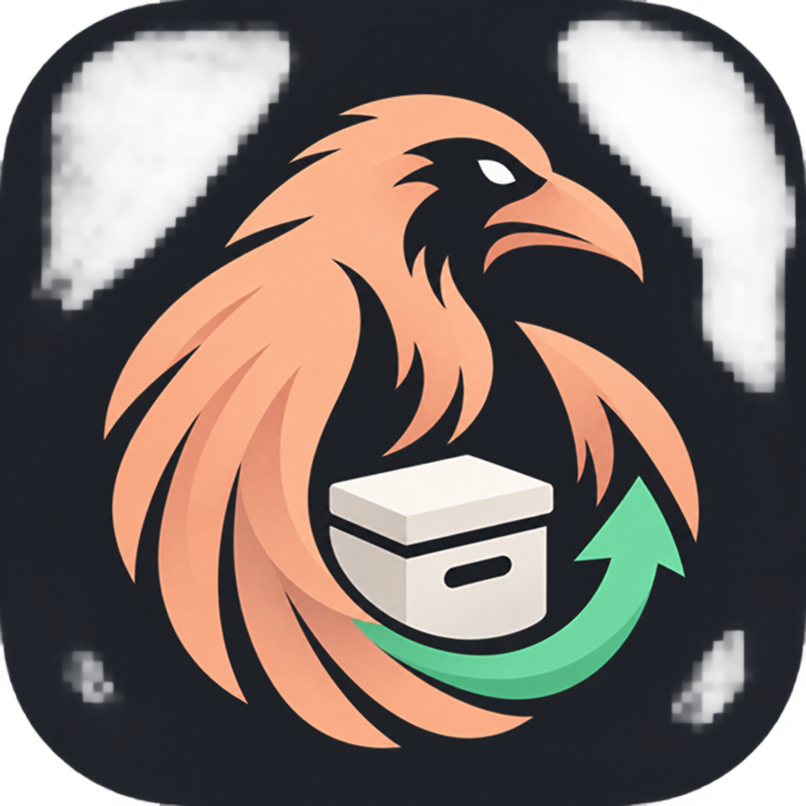

# Raven Backup

Raven Backup is an experimental Android app for backing up user-app private data and, optionally, the original APKs and installed splits. Its root backend was tested on an **AYN Odin 2** using the OEM `PServerBinder` service.

**Current version:** 1.4.1 · **Package:** `dev.raven.backup` · **License:** GPL-3.0-only

Selected as the [final build for the current milestone](RELEASE-STATUS.md) on October 17, 2026.

> **Guided first launch:** choose a backup folder and approve Android's storage prompts. Press **Run checks** to check root, folder access and existing ZIPs, then verify live restore with a temporary disposable app. A themed **Testing…** popup shows progress; a **Done** popup confirms success. Tap **Continue** to open the main screen. The helper diagnostic screen stays hidden and the test app is removed. Failures stay in setup with a retry option. Already-configured installations open normally; revisit **Settings > Guided setup** any time.

## Download and install

The current signed APK is [RavenBackup-1.4.1.apk](releases/v1.4.1/RavenBackup-1.4.1.apk). Verify it with [SHA256SUMS.txt](releases/v1.4.1/SHA256SUMS.txt), then follow [Installation](docs/INSTALL.md).

For a wiped device, follow the complete [Restore after a factory reset](docs/FACTORY-RESET.md) guide, including storage permissions, live-restore setup and Play Store sign-in for licensed apps.

Read [Removal and cleanup](docs/UNINSTALL.md) before uninstalling, especially if a restore was interrupted. Keep independent copies of important backups.

## What it does

- Select multiple installed user apps for backup, with a ZIP per app and a history of versions.
- Include the original signed base APK and installed splits, or back up private data only.
- Choose a local/internal-storage or portable SD destination through Android's folder picker.
- Name new archives `AppName_MM-DD-YYYY.zip`, with `_2`, `_3`, etc. for additional same-day versions.
- On verified devices, review and restore a backup or queue different apps in selection order. Each restore checks content, ownership, permissions and SELinux labels. Queues stop on error; earlier successful restores stay restored.
- Keep a temporary recovery copy during live restore; optionally retain an exported rollback ZIP.
- Delete selected ZIPs, or **Purge everything inside the selected folder, including non-ZIP files and all subfolders**, after confirmation. The selected root folder is kept.
- Schedule approximate daily/weekly backups and choose light/dark/system appearance with a custom accent color.

## Supported scope

Android 11/API 30 is the minimum declared version. The demonstrated root backend and live restore were tested on two Odin 2 devices (stock 318 and a stock-318-based fingerprint-spoofed build) with **SELinux Permissive**. Enforcing SELinux, other devices/firmware, secondary users, system apps and shared-UID apps are not established as supported. A similarly named Run as root option on another device is not evidence of compatibility. Generic `su`/Magisk support is not implemented.

Only use backups you trust: ZIPs are unencrypted and not cryptographically authenticated. Android Keystore keys, store entitlement, accounts, runtime grants, external game downloads, ACLs and arbitrary filesystem capabilities are not reproduced by copying private files/APKs. Restore requires compatible framework/vendor firmware identities and app version/signatures. Legacy backups retain the exact-fingerprint rule with one documented exception for the Odin 2 stock-318/Pixel-10-Pro spoof pair; unrelated firmware changes remain blocked. Google Play still checks real account entitlement. See [Usage and limits](docs/USAGE.md).

## Source and building

The app uses Java and Android framework APIs without a Gradle dependency graph. [Build instructions](docs/BUILD.md) describe the Windows PowerShell/JDK/Android SDK build, local signing and host tests. The release signing key and SDK tools are deliberately not included.

- `src/`, `res/`, `AndroidManifest.xml`: app source and resources.
- `build.ps1`: portable app/fixture build script.
- `tests/`: host checks, Android test helper and disposable fixture source.
- `releases/v1.4.1/`: the current signed APK and checksum.
- `docs/`: installation, removal, usage, build and validation notes.

## License and contributions

Copyright (C) 2026 Raven Backup contributors. This project, including its app source and project artwork, is licensed under **GNU GPL version 3 only**; see [LICENSE](LICENSE). Distributed modified versions must comply with that license and provide corresponding source. Private modifications do not have to be published. This does not impose a license on the user's backed-up apps or data. See the [GNU licensing FAQ](https://www.gnu.org/licenses/gpl-faq.en.html#GPLRequireSourcePostedPublic).

See [CONTRIBUTING.md](CONTRIBUTING.md), [SECURITY.md](SECURITY.md), [CHANGELOG.md](CHANGELOG.md), and [THIRD_PARTY_NOTICES.md](THIRD_PARTY_NOTICES.md).
