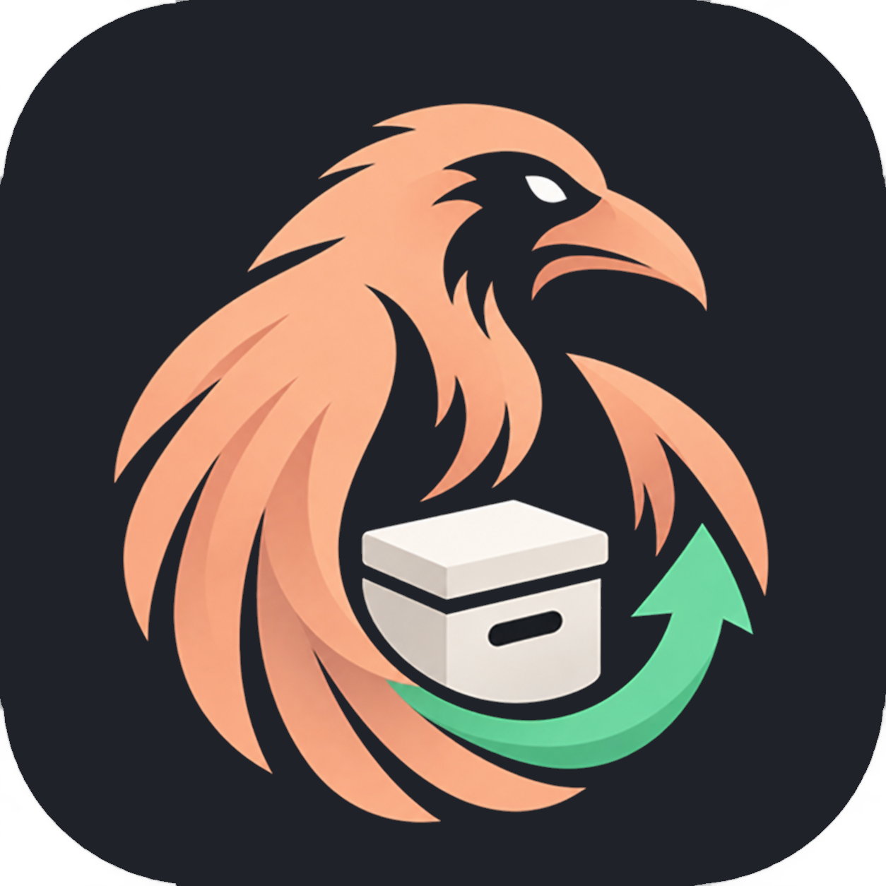

# Raven Backup

**Your apps. Your progress.**

Raven Backup is an experimental Android app for backing up user-app private data and, optionally, the original APKs, installed splits, and primary external app files. Its root backend was tested on **AYN Odin 2 and Odin 3** using the OEM `PServerBinder` service.

**Final build for the current milestone.** Adds [device and Android migration warnings](docs/MIGRATION.md), plus [tagged recovery backups and selective cleanup](docs/RECOVERY.md). Odin 2-to-Odin 3 app/data restores passed file and metadata verification; app-level compatibility still varies.

## What it does

- Select multiple installed user apps for backup, with a ZIP per app and a history of versions. Search for apps one at a time without losing selections, then use **Show selected** to review them together.
- Include the original signed base APK and installed splits, or back up private data only. Stream primary external app files into the ZIP, enabled by default for new settings; existing choices are preserved. Raven 1.7.2 reads older backups. New streamed ZIPs require 1.7.0 or newer.
- Choose one local/internal-storage or portable SD folder for both backups and the Restore list. Storage permission is requested only when missing.
- Handle legitimate newline filenames and recreate private app FIFOs. Allow app-scoped symbolic links to the same app’s primary external files; verify linked files exist in a staged external restore. Other links and device nodes remain blocked.
- Name new archives `AppName_MM-DD-YYYY.zip`, with `_2`, `_3`, etc. for additional same-day versions.
- Review local/SD restore queues using checked metadata first. Fully validate private data and installers at each app’s turn, and validate/write large external files together before replacing app data. Non-seekable inputs and older multi-app ZIPs keep full up-front validation.
- Export and review/import theme, backup/restore preferences, backup order and schedule choices through **Settings > Settings & configuration**. Imported schedules stay off until reviewed and enabled; folder permissions and device approval are kept on the current device and must be set up again after a wipe.
- On verified devices, review and restore a backup or queue different apps in selection order. Each restore checks content, ownership, permissions and SELinux labels. Incompatible apps are skipped with reasons in the final report; data/recovery failures stop the queue. Earlier successful restores stay restored. Opening apps afterward defaults to off.
- Create temporary transaction recovery protection and retain separately tagged per-app recovery ZIPs until deleted through **Settings > Backup preferences > Manage recovery backups**.
- Delete selected ZIPs after confirmation. **Settings > Advanced > Purge all backups** can empty the chosen backup folder, including non-ZIP files and all subfolders, after confirmation; the selected root folder is kept.
- Prepare app-size estimates and choose Package ID, App name or Size order, ascending or descending, in Backup preferences. Optional Usage access speeds size estimates; checked file counting remains available.
- Keep manual backups/restores running with the screen off using an ongoing notification and CPU wake lock, subject to Android background limits. Progress names the current app and its position in the batch.
- Back up eligible system-app data without APKs, with strict same-device/firmware restore checks. Persistent apps that cannot stay stopped, including tested Odin 3 Game Assistant, are refused with a warning.
- Schedule approximate daily/weekly backups with charging/idle options and optional Android battery-optimization exemption.
- Choose light, dark or system appearance and customize the accent using a color wheel, RGB sliders, hex input or Raven-family presets.
- Enable explicit signature or version overrides under Restore preferences for data-only restore to an installed app with the same package ID. Raven keeps the installed APK and creates a recovery copy.
- Open **Settings**, **About** and **Report an issue** from the three-dot menu. Issue reports open on GitHub with the app version filled in. The collapsed **Advanced** card uses two buttons per row with short descriptions and contains **Rerun Guided Setup**, backup verification, root-access testing, interrupted-restore recovery and restore rehearsal. First-launch checks start only when **Run checks** is pressed. Setup tests the device and folder without scanning existing backups. Payload validation finishes before an app’s data is replaced; failed backups are flagged with reasons and can be selected for confirmed deletion. A full library scan is available on demand in Advanced.

## Supported scope

Android 11/API 30 is the minimum declared version. The demonstrated root backend and live restore were tested on two Odin 2 devices (stock 318 and a stock-318-based fingerprint-spoofed build) with **SELinux Permissive**. Odin 2 Android 13 backups were also restored on an Odin 3 running Android 15/API 35. Enforcing SELinux, other untested devices/firmware, secondary users and most shared-UID apps are not supported. Eligible system-app data has a narrower same-identity restore policy; Game Assistant remains unsupported while running. A similarly named Run as root option on another device is not evidence of compatibility.

Only use backups you trust: ZIPs are unencrypted and not cryptographically authenticated. Android Keystore keys, store entitlement, accounts, runtime grants, external game downloads, ACLs and arbitrary filesystem capabilities are not reproduced by copying private files/APKs. Device, Android-version or firmware differences require a migration warning and explicit confirmation. Archive integrity, app package and version, signing review, destination ownership and supported security-label checks remain required. Real cross-device/OS behavior is app-dependent; successful file verification does not prove game progress or account access. Google Play still checks real account entitlement. See [Usage and limits](docs/USAGE.md).

## Source and building

The app uses Java and Android framework APIs without a Gradle dependency graph. [Build instructions](docs/BUILD.md) describe the Windows PowerShell/JDK/Android SDK build, local signing and host tests. The release signing key and SDK tools are deliberately not included.

- `src/`, `res/`, `AndroidManifest.xml`: app source and resources.
- `build.ps1`: portable app/fixture build script.
- `tests/`: host checks, Android test helper and disposable fixture source.
- `releases/v1.7.2/`: the current signed APK and checksum.
- `docs/`: installation, removal, usage, build and validation notes.

## License and contributions

Copyright (C) 2026 Raven Backup contributors. This project, including its app source and project artwork, is licensed under **GNU GPL version 3 only**; see [LICENSE](LICENSE). Distributed modified versions must comply with that license and provide corresponding source. Private modifications do not have to be published. This does not impose a license on the user's backed-up apps or data. See the [GNU licensing FAQ](https://www.gnu.org/licenses/gpl-faq.en.html#GPLRequireSourcePostedPublic).

See [CONTRIBUTING.md](CONTRIBUTING.md), [SECURITY.md](SECURITY.md), [CHANGELOG.md](CHANGELOG.md), and [THIRD_PARTY_NOTICES.md](THIRD_PARTY_NOTICES.md).
